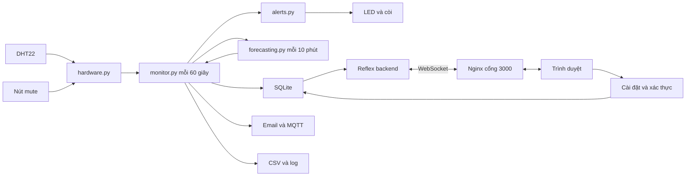

# Mapping dự án và hướng dẫn triển khai Raspberry Pi 4

Tài liệu cho bản giám sát nhiệt độ, độ ẩm và dự báo tối đa 12 giờ. Thiết bị mục tiêu là Raspberry Pi 4 RAM 2 GB chạy Raspberry Pi OS Lite 64-bit có systemd. PC dùng để phát triển, huấn luyện và build frontend trước khi chuyển sang Pi.

## Luồng hoạt động



Monitor quản lý cảm biến và GPIO. Dashboard đọc SQLite, làm mới mỗi 5 giây. SQLite dùng WAL để monitor và dashboard truy cập đồng thời. Thời gian hiển thị theo Việt Nam.

Dự báo gồm 72 mốc cách nhau 10 phút. Phương pháp chu kỳ ngày có hiệu chỉnh theo số đo mới hoạt động khi chưa đủ điều kiện dùng LSTM. LSTM nhận 24 giờ đầu vào gồm nhiệt độ, độ ẩm và sin/cos giờ trong ngày, dự báo trực tiếp toàn bộ 72 mốc.

## Sơ đồ chân toàn bộ mạch

GPIO trong mã dùng cách đánh số BCM. Cột chân vật lý chỉ vị trí trên header 40 chân của Pi.

| Thiết bị | BCM | Chân vật lý | Đấu nối |
| --- | --- | --- | --- |
| DHT22 DATA | GPIO4 | 7 | Kéo lên 3.3V qua trở 4.7–10 kΩ nếu module chưa có trở |
| DHT22 VCC | — | 1 | 3.3V |
| DHT22 GND | — | 6 hoặc 9 | GND chung |
| LED xanh | GPIO17 | 11 | Cực dương qua điện trở hạn dòng 220 Ω, cực âm về GND |
| LED vàng | GPIO27 | 13 | Cực dương qua điện trở hạn dòng 220 Ω, cực âm về GND |
| LED đỏ | GPIO22 | 15 | Cực dương qua điện trở hạn dòng 220 Ω, cực âm về GND |
| Còi PWM, chân I/O | GPIO18 | 12 | PWM 1000 Hz, duty cycle 50% khi phát âm |
| Nguồn còi | — | Chân nguồn phù hợp module | Cấp đúng điện áp định mức module, nối GND chung |
| Nút tắt tiếng | GPIO23 | 16 | Một đầu vào GPIO23, đầu còn lại về GND, dùng pull-up nội |

## Mapping mã nguồn và công cụ

| Tệp hoặc thư mục | Vai trò |
| --- | --- |
| `common.py` | GPIO, chu kỳ đo, thời gian Việt Nam, đường dẫn, đọc và kiểm tra cấu hình `.env` |
| `.env` | Tài khoản SMTP, ngưỡng/email mặc định, MQTT và đường dẫn DB tùy chọn |
| `hardware.py` | DHT22 có thử lại, LED, còi PWM, nút mute và giải phóng GPIO |
| `monitor.py` | Vòng đo, lịch dự báo, cảnh báo, lưu dữ liệu, email và MQTT |
| `alerts.py` | Phân loại thấp/cao, xác nhận cảnh báo, tìm mốc đỏ đầu tiên |
| `notifications.py` | SMTP SSL, chống lặp, lưu trạng thái gửi và thử lại khi lỗi |
| `storage.py` | SQLite, nhập CSV, truy vấn lịch sử và gộp min/mean/max |
| `provenance.py` | Kiểm tra hash và nhận diện nguồn dữ liệu mô phỏng |
| `runtime_settings.py` | Kiểm tra/lưu ngưỡng và email, phát hiện xung đột hai phiên sửa |
| `forecasting.py` | Gộp dữ liệu 10 phút, dự báo chu kỳ, suy luận LSTM và dải sai số |
| `train_forecast.py` | Huấn luyện LSTM 12 giờ, đánh giá baseline, xuất mô hình/metadata |
| `dashboard_data.py` | Dữ liệu hiển thị, kiểm tra độ mới, lọc dự báo và xuất CSV |
| `dashboard_auth.py` | Băm mật khẩu PBKDF2-SHA256, đăng nhập, hết hạn phiên và đổi mật khẩu |
| `iot_dashboard/iot_dashboard.py` | Giao diện Reflex, biểu đồ, đăng nhập, lịch sử và cài đặt |
| `iot_dashboard/__init__.py` | Khai báo package giao diện |
| `rxconfig.py` | Reflex 0.9.13 và cấu hình giao diện dark mode |
| `dashboard.py` | Lối chạy dashboard trên PC bằng `python dashboard.py` |
| `check_system.py` | Một bản kiểm tra cả mạch, môi trường thư viện và cấu hình |
| `test_suite.py`, `pytest.ini` | Bộ kiểm thử tự động cho dữ liệu, cảnh báo, mô hình, xác thực và đóng gói |
| `generate_weather_data.py` | Sinh dữ liệu phút theo khí tượng, lưu nguồn và sao lưu CSV trước khi thay |
| `prepare_pi.py` | Build frontend trên PC, kiểm tra build và đóng gói ZIP |
| `pi_deploy.py` | Kiểm tra checksum nguồn/build, sinh cấu hình Nginx |
| `install_pi.sh` | Cài trên Pi, tạo `.env` khi cần và sinh ba dịch vụ systemd |
| `start_monitor.sh` | Chạy monitor với giới hạn thread TensorFlow/BLAS |
| `start_dashboard.sh` | Chạy Reflex backend một worker tại loopback cổng 8000 |
| `deploy/frontend/` | HTML/JS/CSS đã build để Nginx phục vụ |
| `deploy/frontend_manifest.json` | Phiên bản Reflex và checksum nguồn/frontend |
| `scripts/verify_dashboard.py` | Kiểm thử biểu đồ, lịch sử, CSV và mobile bằng trình duyệt |
| `scripts/verify_settings_ui.py` | Kiểm thử lưu cài đặt, validation và xung đột hai phiên |
| `scripts/verify_auth_ui.py` | Kiểm thử đăng nhập, đổi mật khẩu, thu hồi phiên và đăng xuất |
| `scripts/verify_pi_deployment.py` | Kiểm thử static build, Nginx, backend-only và tên máy LAN trên Windows |
| `scripts/qa_helpers.py` | Hàm đăng nhập dùng chung cho bài kiểm thử giao diện |
| `reflex.lock/` | Lockfile frontend phục vụ build trên PC |
| `README.md` | Tham chiếu tính năng và lệnh vận hành |
| `HUONG_DAN_TRIEN_KHAI.md` | Mapping và quy trình triển khai trong tài liệu này |
| `markdown.md`, `NHUNG_GI_DA_LAM.md` | Bối cảnh học thuật và thực nghiệm lịch sử của bản 10 phút |
| `.gitignore` | Quy tắc bỏ qua môi trường, thông tin riêng và tệp sinh khi chạy |

### Bộ thư viện

| Tệp | Sử dụng |
| --- | --- |
| `requirements.txt` | NumPy, pandas, dotenv, tzdata, Reflex và MQTT |
| `requirements-pi.txt` | Bộ chung cùng GPIO, gpiozero và driver DHT22 |
| `requirements-inference.txt` | Bộ chung cùng TensorFlow để suy luận |
| `requirements-ml.txt` | Bộ suy luận và matplotlib cho công việc mô hình trên PC |
| `requirements-dev.txt` | Bộ chung cùng pytest |

## Mapping dữ liệu

| Đường dẫn | Nội dung |
| --- | --- |
| `data/sensor_data.csv` | Bộ mô phỏng hiện tại, có `time,temp,hum,label`; nguồn được ghi trong metadata/SQLite, monitor ghi số đo thật riêng vào `live_sensor_data.csv` |
| `data/sensor_data.provenance.json` | Nguồn, thời gian, số mẫu và hash phần mô phỏng khí tượng |
| `data/weather_sources/` | JSON khí tượng gốc và dữ liệu đối chiếu vùng |
| `data/weather_hourly_reference.csv` | Dữ liệu tham chiếu giờ |
| `data/weather_daily_summary.csv` | Thống kê ngày |
| `data/WEATHER_DATA_README.md` | Mô tả nguồn và cách tái lập |
| `data/iot.sqlite3` | DB vận hành, tạo khi cài/chạy chương trình |
| `data/iot.sqlite3-wal`, `data/iot.sqlite3-shm` | Tệp hỗ trợ SQLite WAL |
| `data/monitor_log.csv` | Số đo, trạng thái và giá trị ở mốc dự báo kế tiếp |
| `model/forecast_12h.keras` | Mô hình LSTM 12 giờ sau huấn luyện |
| `model/forecast_12h.json` | Chuẩn hóa, định dạng, sai số và quyết định `use_lstm` |
| `deploy/nginx.conf` | Cấu hình installer sinh với đường dẫn release trên Pi |
| `data/backups/` | Bản sao CSV cũ do chương trình sinh dữ liệu tạo khi thay bộ dữ liệu |
| `.web/`, `.states/`, `__pycache__/` | Frontend phát triển, phiên Reflex và cache Python được sinh khi sử dụng |

Bộ dữ liệu hiện có gồm 43.200 mẫu phút trong 30 ngày, từ 11/10/2026 22:21 đến 10/11/2026 22:20. Nguồn khí tượng Hà Đông được nội suy và thêm nhiễu nhỏ để mô phỏng chuỗi cảm biến. Các mẫu này mang nhãn `weather_sample`. Sai số học trên bộ này đánh giá thử nghiệm với dữ liệu mô phỏng.

Trong SQLite, `readings` chỉ có `time,temp,hum,state,reasons`. Nguồn nằm riêng trong `reading_origins(time,origin)`; `Store.frame()` ghép thành trường `source` cho code đọc. `kv` lưu trạng thái monitor/dự báo, cấu hình, xác thực, nguồn và trạng thái email. Dashboard dùng trường `source=sensor/demo` cho số đo trực tiếp, đồng thời kiểm tra thời gian cập nhật và trạng thái monitor. Khi chuyển DB cấu trúc mới sang Pi, cần dùng cùng bản code mới; code mới tự chuyển DB cũ khi mở.

## Trước khi bắt đầu

Các bước bên dưới dùng PC Windows PowerShell và Pi cài lần đầu tại `~/v1-main`, với lựa chọn cài TensorFlow để có thể suy luận LSTM. Ví dụ MQTT đặt broker ngay trên Pi. Bạn cần Pi 4, nguồn cấp phù hợp, thẻ microSD, mạch đã đấu theo bảng chân và kết nối mạng.

Trên PC, dùng Raspberry Pi Imager để ghi Raspberry Pi OS Lite 64-bit lên thẻ. Trong phần tùy chỉnh, đặt tên tài khoản và mật khẩu Pi, thiết lập Wi-Fi nếu dùng, bật SSH. Ghi lại tài khoản đã tạo. Sau khi Pi khởi động, lấy IP từ router hoặc lệnh `hostname -I` trên terminal của Pi. [Raspberry Pi Imager](https://www.raspberrypi.com/software/)

Giữ cùng một cửa sổ PowerShell trên PC suốt quy trình. Khi chạy `ssh`, cửa sổ chuyển thành terminal Pi. Lệnh `exit` trong phiên SSH đưa bạn về PowerShell PC.

## Bước 1 — PC, kiểm tra môi trường

Mở PowerShell trên Windows và chạy lần lượt.

```powershell
cd C:\Users\hoang\Downloads\iot\v1-main
..\.venv\Scripts\python.exe --version
Get-Command ssh, scp
```

Môi trường `.venv` đã được chuẩn bị trong thư mục `iot`. Nếu đang chuẩn bị lại trên máy mới và chưa có môi trường này, cài Python 3.11 rồi tạo bằng lệnh sau từ `v1-main`.

```powershell
py -3.11 -m venv ..\.venv
```

Cài dependency và chạy kiểm thử.

```powershell
..\.venv\Scripts\python.exe -m pip install -r requirements-dev.txt
..\.venv\Scripts\python.exe -m pip check
..\.venv\Scripts\python.exe -m pytest -q
```

Đợi pytest hoàn thành. Dòng cuối cần cho biết các bài test đạt. Bài kiểm thử Keras được chạy khi PC có TensorFlow, hoặc được đánh dấu skip nếu thư viện tùy chọn này chưa cài.

## Bước 2 — PC, tạo mô hình thử nghiệm LSTM

Bộ hiện có là dữ liệu phút mô phỏng từ khí tượng Hà Đông. Để thử huấn luyện trước khi thu đủ dữ liệu DHT22, chạy lần lượt.

```powershell
..\.venv\Scripts\python.exe -m pip install -r requirements-ml.txt
..\.venv\Scripts\python.exe train_forecast.py --db data/training_data.sqlite3 --skip-csv-import --epochs 60 --include-weather-samples
```

DB `training_data.sqlite3` thuộc bộ mô phỏng hiện tại và đã loại các mẫu dùng forecast; `--skip-csv-import` tránh nhập lại toàn bộ CSV tham khảo vào DB train. Sau khi chương trình kết thúc, kiểm tra hai tệp mô hình và metadata.

```powershell
Get-Item .\model\forecast_12h.keras, .\model\forecast_12h.json
Get-Content .\model\forecast_12h.json -Raw | ConvertFrom-Json | Select-Object use_lstm, training_data_kind, validation_rmse, baseline_validation_rmse, model_sha256
```

`use_lstm=true` cho biết LSTM thắng baseline trên cả nhiệt độ và độ ẩm ở validation. Khi `use_lstm=false`, monitor tiếp tục chọn dự báo chu kỳ. Metadata ghi rõ nguồn mô phỏng và checksum mô hình. Tệp `.keras` và `.json` cần lấy từ cùng một lần huấn luyện.

Huấn luyện chính thức dùng ít nhất 7 ngày số đo hợp lệ, khuyến nghị 14–30 ngày số đo thật. Quy trình lấy dữ liệu thực về PC nằm ở phần cuối tài liệu. Mô hình thử nghiệm trên khí tượng cần được đánh giá tiếp bằng dữ liệu cảm biến.

## Bước 3 — PC, chuẩn bị ZIP triển khai

Giao diện trong `deploy/frontend` đã được build sẵn. Kiểm tra và đóng gói bằng lệnh sau.

```powershell
..\.venv\Scripts\python.exe prepare_pi.py --check
..\.venv\Scripts\python.exe prepare_pi.py --no-build
Get-Item ..\iot-pi4-2gb.zip
```

Sau khi sửa mã nguồn làm frontend cũ mất hiệu lực, chạy build đầy đủ rồi kiểm tra.

```powershell
..\.venv\Scripts\python.exe prepare_pi.py
..\.venv\Scripts\python.exe prepare_pi.py --check
```

Kết quả chuyển sang Pi gồm ZIP và hai tệp mô hình ở bảng sau. Hai tệp mô hình được chuyển riêng ở bước 6. Installer tạo `.env` vận hành trên Pi và bạn điền thông tin SMTP tại đó.

| Tệp trên PC | Vị trí trên Pi |
| --- | --- |
| `C:\Users\hoang\Downloads\iot\iot-pi4-2gb.zip` | Thư mục home của tài khoản Pi |
| `v1-main/model/forecast_12h.keras` | `~/v1-main/model/forecast_12h.keras` |
| `v1-main/model/forecast_12h.json` | `~/v1-main/model/forecast_12h.json` |

Nếu chỉ sử dụng giám sát và dự báo chu kỳ, bạn có thể chuyển ZIP rồi cài bằng `bash install_pi.sh`. Khi sử dụng LSTM, làm tiếp đầy đủ các bước mô hình và lựa chọn `--with-ml` bên dưới.

## Bước 4 — PC, khai báo Pi và chuyển ZIP

Thay hai giá trị trong dấu nháy kép bằng thông tin thực tế. Ví dụ tài khoản do bạn tạo là `hoang`, IP là `192.168.1.50`, thì điền đúng hai giá trị đó.

```powershell
$piUser = "TEN_DANG_NHAP_PI"
$piIp = "DIA_CHI_IP_PI"
$piTarget = "${piUser}@${piIp}"
scp ..\iot-pi4-2gb.zip "${piTarget}:~/"
ssh $piTarget
```

SSH sẽ hỏi mật khẩu Pi. Sau khi đăng nhập thành công, các lệnh ở bước 5 chạy trên Pi.

## Bước 5 — Pi, giải nén và cài

```bash
sudo apt update
sudo apt install -y unzip
unzip ~/iot-pi4-2gb.zip -d ~
cd ~/v1-main
getconf LONG_BIT
bash install_pi.sh --with-ml
```

`getconf LONG_BIT` cần trả về `64`. Chạy installer bằng tài khoản thường có quyền sudo. Script tự cài dependency, tạo venv với `--system-site-packages`, chuẩn bị `.env`, nhập lịch sử và sinh ba dịch vụ. Frontend được phục vụ từ release riêng trong `/var/www/iot-dashboard/`.

Cặp mô hình được huấn luyện lại ngày 13/11/2026 hiện ghi `use_lstm=true`, nên quy trình này dùng `--with-ml` để cài TensorFlow. Hai tệp mô hình vẫn cần chuyển riêng ở bước 6; LSTM cần đủ khoảng 24 giờ đầu vào gần nhất. Nếu chỉ dùng dự báo chu kỳ, chạy `bash install_pi.sh` để cài bộ cơ bản. Installer đợi tối đa 90 giây để backend trả lời `/ping` qua Nginx rồi kiểm tra cả ba dịch vụ; hết thời gian chờ sẽ báo lỗi cùng lệnh xem log.

| Dịch vụ | Công việc | Địa chỉ |
| --- | --- | --- |
| `iot-monitor` | Đọc DHT22, dự báo, LED/còi, email và MQTT | GPIO và SQLite |
| `iot-dashboard` | Reflex backend một worker | `127.0.0.1:8000` |
| `iot-web` | Nginx, frontend và proxy API/WebSocket | Cổng 3000 |

Kiểm tra dịch vụ sau khi cài.

```bash
sudo systemctl status iot-monitor iot-dashboard iot-web
```

Ba dịch vụ cần ở trạng thái `active (running)`. Installer sẽ trả mã lỗi nếu một dịch vụ chưa active. Khi có lỗi, đọc log bằng các lệnh ở phần xử lý lỗi cuối tài liệu.

Venv dùng GPIO từ gói hệ thống. Yêu cầu phiên bản đã chấp nhận bản `0.7.1a4` được Debian cung cấp. [Gói GPIO trên Debian Trixie](https://packages.debian.org/trixie/arm64/python3-rpi.gpio/filelist)

Trở lại cửa sổ PC để chuyển mô hình.

```bash
exit
```

## Bước 6 — PC chuyển mô hình, Pi nạp mô hình

Trong PowerShell PC vẫn ở thư mục `v1-main`, chạy.

```powershell
scp .\model\forecast_12h.keras .\model\forecast_12h.json "${piTarget}:~/v1-main/model/"
ssh $piTarget
```

Trong terminal Pi, chạy.

```bash
cd ~/v1-main
ls -lh model/forecast_12h.keras model/forecast_12h.json
sudo systemctl restart iot-monitor
journalctl -u iot-monitor -n 30 --no-pager
```

Monitor kiểm tra checksum để phát hiện cặp mô hình/metadata bị chép dở hoặc lệch lần huấn luyện. Điều kiện chạy LSTM gồm `use_lstm=true`, nạp mô hình thành công và đủ chuỗi đầu vào gần nhất khoảng 24 giờ. Dự báo chu kỳ hoạt động trong thời gian thu đầu vào.

## Bước 7 — Pi, test toàn bộ mạch

Dừng monitor trước khi test GPIO.

```bash
sudo systemctl stop iot-monitor
venv/bin/python check_system.py --hw-only
sudo systemctl start iot-monitor
```

`check_system.py` là bản test chung cho toàn bộ mạch. Chương trình dùng khóa GPIO chung với monitor để phát hiện chạy trùng.

| Bước test | Thao tác | Điều kiện đạt |
| --- | --- | --- |
| 1 | LED xanh nhấp nháy 3 lần | Thấy đúng LED và xác nhận `c`/`y` |
| 2 | LED vàng nhấp nháy 3 lần | Thấy đúng LED và xác nhận |
| 3 | LED đỏ nhấp nháy 3 lần | Thấy đúng LED và xác nhận |
| 4 | Còi PWM phát 2 tiếng bíp | Nghe rõ 2 tiếng và xác nhận |
| 5 | Nhấn nút trong 8 giây | Chương trình phát hiện nhấn |
| 6 | DHT22 đọc 5 lần, cách nhau 2,5 giây | Ít nhất 3 số đo hợp lệ |

Chương trình in PASS/WARN/FAIL. Mã thoát 0 cho biết mọi thiết bị đạt, mã 1 cho biết còn mục cần kiểm tra. Sau khi dừng bài test bằng Ctrl+C, chạy lại lệnh khởi động monitor để tiếp tục vận hành.

Các chế độ kiểm tra bổ sung dùng cùng tệp.

```bash
venv/bin/python check_system.py --config-only
venv/bin/python check_system.py --env-only
```

## Bước 8 — PC mở dashboard, Pi cấu hình SMTP

Trên trình duyệt PC hoặc điện thoại cùng mạng, mở `http://DIA_CHI_IP_PI:3000`. Mật khẩu khởi tạo là `123456`. Tab Cài đặt có mục đổi mật khẩu.

Tạo Gmail App Password bằng tài khoản gửi đã bật Xác minh 2 bước. Bạn có thể chuẩn bị thao tác này trên trình duyệt PC. [Hướng dẫn Google](https://support.google.com/accounts/answer/185833?hl=vi)

Trên terminal Pi, mở cấu hình.

```bash
cd ~/v1-main
nano .env
```

Điền tài khoản gửi và App Password thật.

```dotenv
EMAIL_SMTP=smtp.gmail.com
EMAIL_PORT=465
EMAIL_FROM=GMAIL_GUI_CUA_BAN@gmail.com
EMAIL_PASS="DAN_APP_PASSWORD_VAO_DAY"
```

Trong nano, lưu bằng Ctrl+O rồi Enter, thoát bằng Ctrl+X. Sau đó chạy.

```bash
venv/bin/python check_system.py --config-only
sudo systemctl restart iot-monitor iot-dashboard
```

Trên dashboard, vào Cài đặt, điền email nhận, bật công tắc email và bấm Lưu cài đặt. `.env` cung cấp mặc định ban đầu. Các ngưỡng/email nhận đã lưu trong SQLite được ưu tiên và được monitor áp dụng tự động.

Gửi một email thử tới người nhận đã lưu bằng lệnh sau trên Pi.

```bash
venv/bin/python -c 'from storage import Store; from notifications import EmailNotifier; EmailNotifier(Store())._send("[IoT] Test email", "Kiem tra email tu Raspberry Pi"); print("Da gui email thu")'
```

Kiểm tra hộp thư đến và thư rác. Email cảnh báo vận hành được gửi khi đỏ hiện tại đã xác nhận hoặc dự báo có mốc chạm đỏ trong 12 giờ, với cooldown mặc định 1800 giây cho cùng loại cảnh báo.

## Bước 9 — Pi, bật MQTT với broker cùng Pi

```bash
sudo apt update
sudo apt install -y mosquitto mosquitto-clients
sudo systemctl enable --now mosquitto
sudo nano /etc/mosquitto/conf.d/iot-local.conf
```

Điền cấu hình listener chỉ dùng loopback trên Pi.

```conf
listener 1883 127.0.0.1
allow_anonymous true
```

Lưu và thoát nano. Listener được cấu hình tường minh với chế độ truy cập tương ứng. [Tài liệu Mosquitto](https://mosquitto.org/documentation/migrating-to-2-0/)

Mở `.env` của dự án.

```bash
cd ~/v1-main
nano .env
```

Đặt ba giá trị sau.

```dotenv
MQTT_ENABLED=true
MQTT_HOST=127.0.0.1
MQTT_PORT=1883
```

Khởi động lại và theo dõi dữ liệu.

```bash
sudo systemctl restart mosquitto iot-monitor
mosquitto_sub -h 127.0.0.1 -t 'pi/#' -v
```

Sau lần đo kế tiếp, khoảng 60 giây, cần thấy `pi/sensor` kèm JSON. Khi có cảnh báo, monitor phát thêm `pi/alert`. MQTT dùng QoS 1. Bấm Ctrl+C để kết thúc lệnh theo dõi.

## Bước 10 — Pi, thử cảnh báo và mute

Ghi lại ngưỡng đang dùng trước khi thử. Ví dụ nhiệt độ hiện tại khoảng 27°C, tạm đặt vàng cao 25°C và đỏ cao 26°C rồi lưu. Vẫn giữ đúng thứ tự đỏ thấp < vàng thấp < vàng cao < đỏ cao.

Ngay số đo hợp lệ đầu tiên chạm ngưỡng đỏ, kiểm tra LED đỏ, còi và email cảnh báo. Monitor đọc mỗi 60 giây nên cần chờ tới lần đo kế tiếp. Email cần bật trong Cài đặt và tuân theo thời gian chống gửi lặp. Nhấn nút để xác nhận còi tắt trong khi LED đỏ phản ánh trạng thái. Nếu còn đỏ sau năm phút, còi tự kêu lại. Khôi phục ngưỡng đã ghi sau khi thử.

| Đại lượng | Đỏ thấp mặc định | Vàng thấp | Vàng cao | Đỏ cao |
| --- | --- | --- | --- | --- |
| Nhiệt độ | 10°C | 15°C | 30°C | 35°C |
| Độ ẩm | 25% | 35% | 75% | 85% |

Lỗi đọc cảm biến làm sáng LED vàng và tắt còi. Dashboard đánh dấu mất cập nhật khi số đo quá ba phút và ẩn dự báo mất dữ liệu đầu vào.

## Bước 11 — Pi, kiểm tra tự chạy và RAM

```bash
sudo reboot
```

Sau khi Pi khởi động, kết nối lại từ PowerShell PC.

```powershell
ssh $piTarget
```

Trên Pi, chạy.

```bash
cd ~/v1-main
sudo systemctl is-enabled iot-monitor iot-dashboard iot-web
sudo systemctl status iot-monitor iot-dashboard iot-web
venv/bin/python check_system.py --config-only
free -h
sudo systemctl show iot-monitor iot-dashboard iot-web -p Id -p MemoryCurrent -p MemoryPeak
```

Mở lại dashboard để xác nhận dữ liệu tiếp tục cập nhật. Khi LSTM đã suy luận, kiểm tra RAM thêm một lần để có số đo vận hành thực tế.

## Huấn luyện tiếp bằng dữ liệu cảm biến thật

Sau khi Pi đã thu đủ dữ liệu, tạo bản sao DB bằng SQLite backup API trên Pi.

```bash
cd ~/v1-main
venv/bin/python -c 'import sqlite3; from common import DB_FILE; src=sqlite3.connect(str(DB_FILE)); dst=sqlite3.connect("data/train_export.sqlite3"); src.backup(dst); dst.close(); src.close(); print("Da tao data/train_export.sqlite3")'
exit
```

Tại PowerShell PC, sao chép snapshot và huấn luyện.

```powershell
scp "${piTarget}:~/v1-main/data/train_export.sqlite3" .\data\pi_train.sqlite3
..\.venv\Scripts\python.exe train_forecast.py --db data/pi_train.sqlite3 --epochs 60
```

Sau khi huấn luyện, kiểm tra `use_lstm` và chuyển cặp `.keras`/`.json` mới theo bước 6. Mô hình dùng `LSTM(48) → Dropout(0.15) → Dense(144) → Reshape(72, 2)`. Dữ liệu chia 70/15/15 theo thời gian, chuẩn hóa trên train. Metadata lưu RMSE/MAE test, RMSE mốc 12 giờ và checksum mô hình.

## Lệnh xử lý lỗi trên Pi

```bash
journalctl -u iot-monitor -n 50 --no-pager
journalctl -u iot-dashboard -n 50 --no-pager
journalctl -u iot-web -n 50 --no-pager
sudo systemctl restart iot-monitor iot-dashboard iot-web
```

| Hiện tượng | Kiểm tra |
| --- | --- |
| DHT22 đọc lỗi | Test mạch, DATA GPIO4, 3.3V/GND và trở kéo |
| Còi phát tiếng tách | Test PWM, nguồn module và GPIO18 |
| Bài test báo khóa GPIO | Dừng service hoặc tiến trình monitor thủ công rồi test lại |
| Trình duyệt mất kết nối | Ba dịch vụ, IP Pi và mạng LAN |
| Lịch sử có dữ liệu nhưng số đo hiện tại trống | Monitor, cảm biến và thời điểm cập nhật |
| Email chưa gửi | App Password, người nhận, công tắc đã lưu, trạng thái gửi và lệnh email thử |
| MQTT chưa có dữ liệu | Mosquitto, địa chỉ/cổng `.env` và lệnh subscribe |
| Frontend sai checksum | Build lại trên PC bằng `prepare_pi.py`, chuyển ZIP mới |
| Mô hình chưa khớp metadata | Chép lại cả hai tệp từ cùng lần huấn luyện rồi restart monitor |
| Dự báo dùng chu kỳ | `use_lstm`, TensorFlow và 24 giờ đầu vào gần nhất |
| CSV ghi lỗi | Đọc journal monitor, kiểm tra quyền ghi và dung lượng thẻ |

## Phạm vi xác minh

Bộ test tự động bao gồm cảnh báo, lịch sử/CSV, dữ liệu mô phỏng, dự báo nhiều bước, Keras khi có TensorFlow, cấu hình, email, xác thực, tài nguyên phần cứng và đóng gói. Các bài kiểm thử trình duyệt trong `scripts/` dùng DB QA riêng, cần Playwright, psutil, Microsoft Edge và Nginx trên Windows.

Kiểm thử PC xác nhận các luồng phần mềm và bản frontend build sẵn. Mạch, nguồn cấp, SMTP thực, RAM và tự chạy sau reboot được xác minh theo các bước trên Pi. Các tệp mô hình chính thức và thông tin SMTP được bổ sung khi bạn thực hiện các bước tương ứng.
